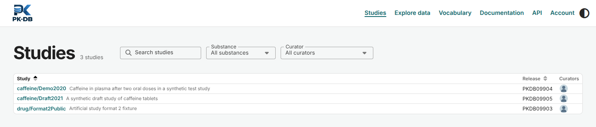
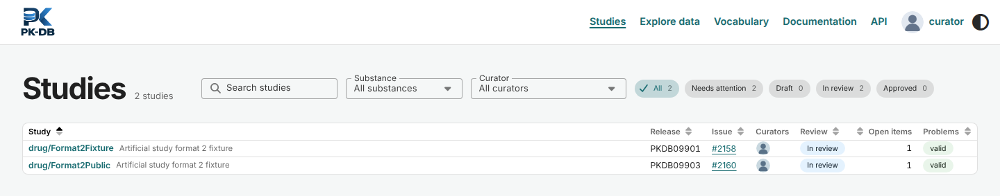
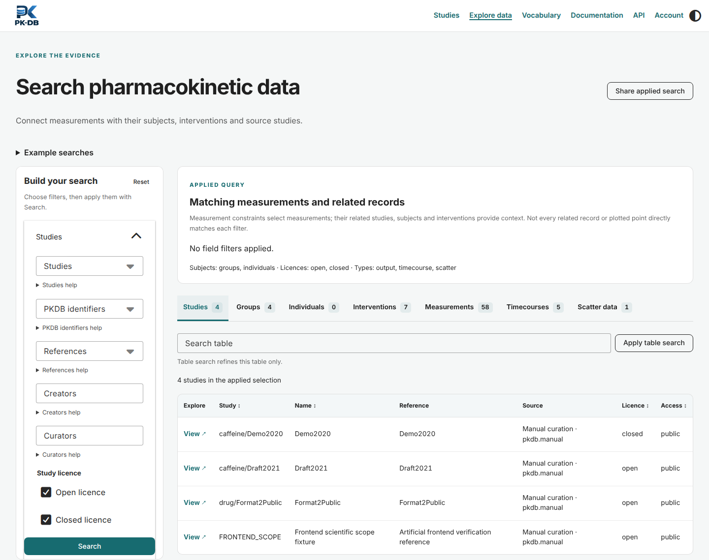
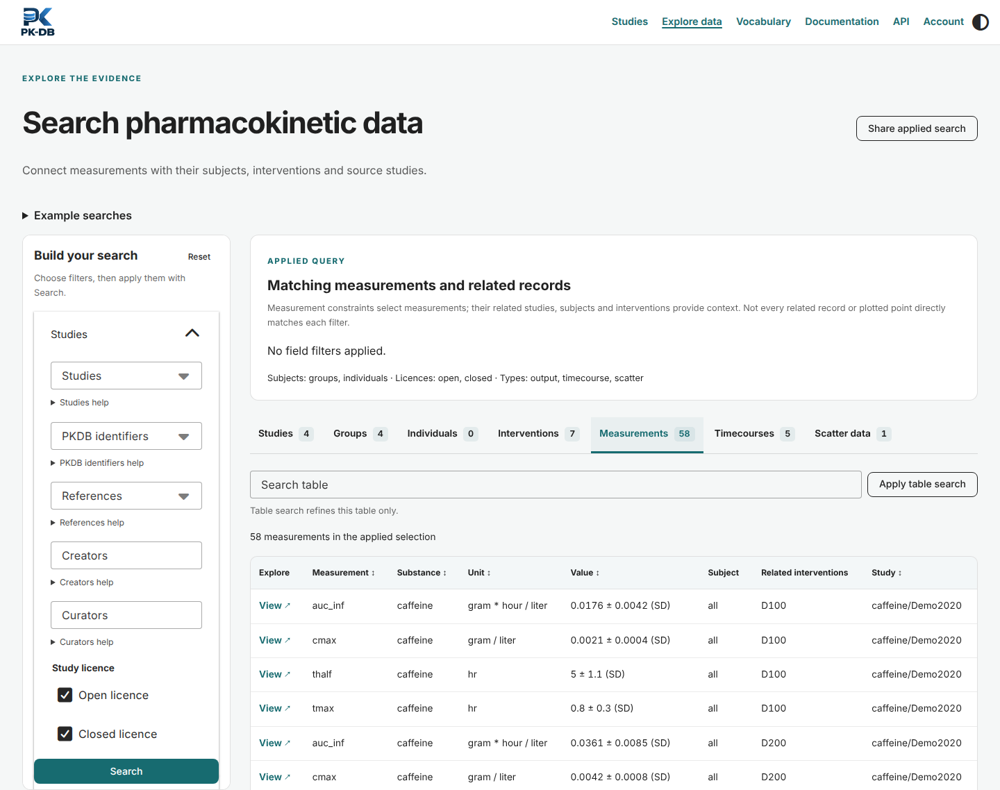
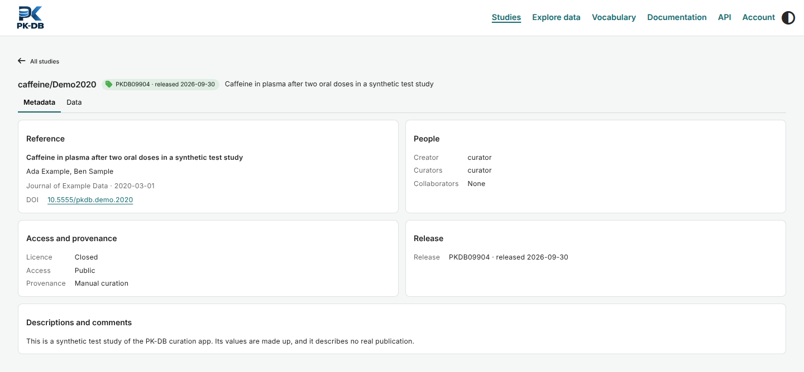
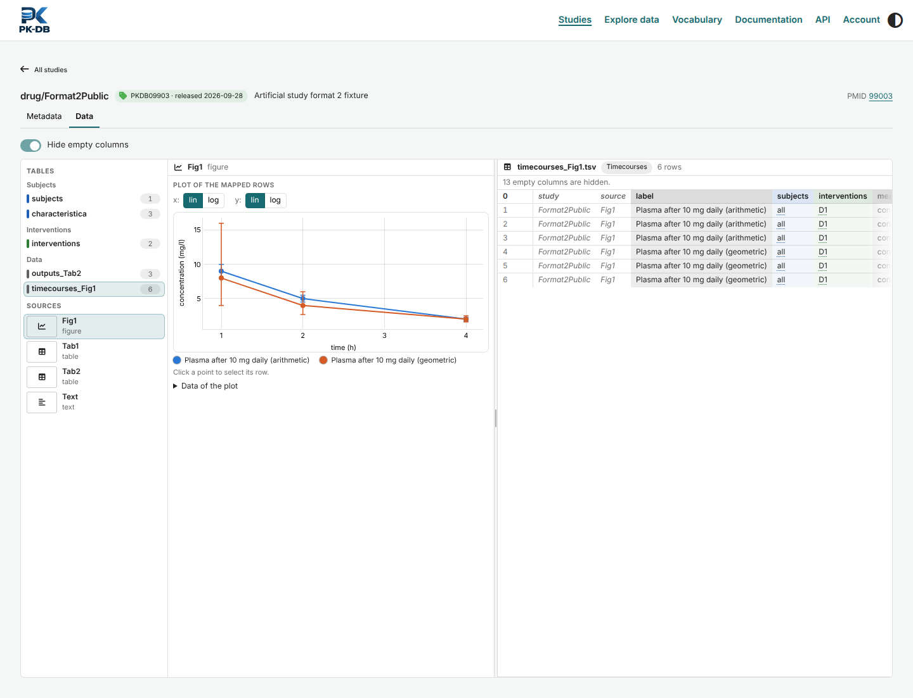
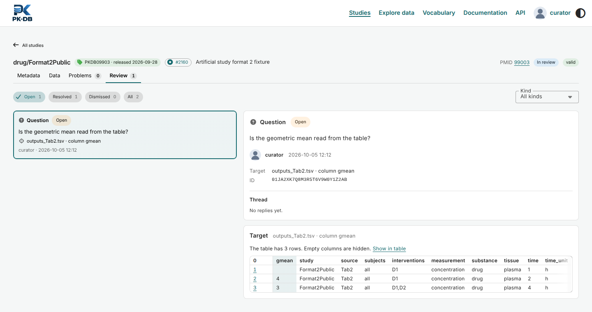
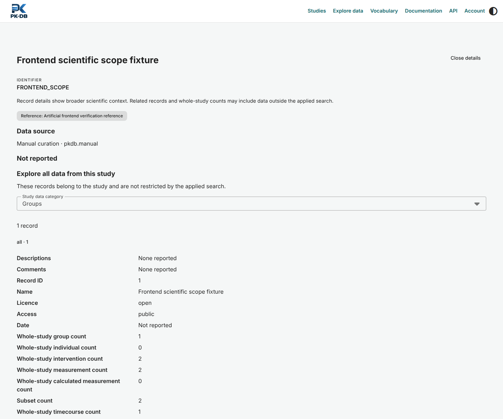
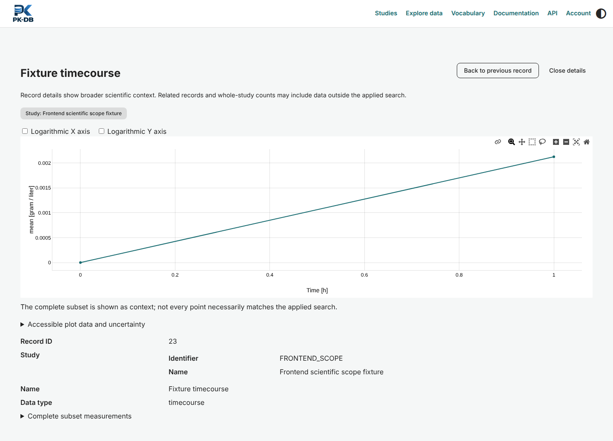
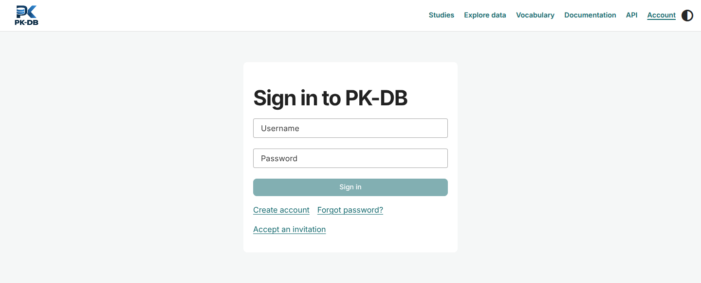

# Webinterface

Open [beta.pk-db.com](https://beta.pk-db.com) to explore PK-DB in your browser. No installation is needed. Public study browsing is available without an account; downloads and access to shared private studies require [sign-in](authentication.md).

The screenshots below show the current frontend with artificial demonstration data. Study names, counts, and values illustrate the interface, not scientific results from the public collection. Select a screenshot to view it at full size. They are rendered from the disposable website of the browser tests, see [Isolated frontend browser checks](local-upload-testing.md#isolated-frontend-browser-checks).

For a scientific example of how a publication is represented in PK-DB, see the [example study](example-study.md).

## Explore database coverage

The landing page shows current totals and interactive charts for studies, substances with timecourses, and PK parameter values. Choose a year range, switch studies and substances between annual and cumulative counts, or select a PK parameter to compare reported and calculated values. The substance chart ranks current timecourse coverage.

Hover for values, drag to zoom, and double-click to reset. Each chart includes a data table and a PNG download. Counts reflect studies you can access and refresh when your session changes. Years use the study date; undated studies appear in current totals and a separate notice. Cumulative substance counts include each substance only once. These charts describe the current collection by study date, not earlier database snapshots.

## Browse studies

Open **Studies** in the main navigation to list the studies that you may read. Each row shows the identity of a study, `<substance>/<name>`, with the title of its publication, the PKDB identifier of its release, and its curators. Select a study to open its [study page](#the-study-page).

**Search studies** matches the identity and the title. **Substance** shows the studies of one substance, also those whose interventions or data name it. **Curator** shows the studies of one curator; when you are signed in, it offers you first as **Me**. Select a column header to sort by it. The Studies page lists the study format 2 studies that have a study page; find the other studies with the data search below.

When you are signed in and may curate one of the listed studies, the list also shows the columns **Issue** (the GitHub issue of the study), **Review** (Draft, In review or Approved), **Open items** (the open review items) and **Problems** (the warnings of the last upload, or **valid**), and the status chips **All**, **Needs attention**, **Draft**, **In review** and **Approved**. These columns are filled for the studies you may curate and show `-` for the others. See [What each reader sees](#what-each-reader-sees).

## Find studies

Open **Explore data** to reach **Search pharmacokinetic data**. The research filters appear on the left on a desktop; on a smaller screen, open **Filters and Search**.

1. Choose the substances, measurement types, subject characteristics, or study criteria relevant to your question.
2. Select the subject types, licences, and measurement types you want to include.
3. Choose **Search** to apply the filters. Editing a filter changes the draft; it does not change the results until you search.
4. Review the applied selection and the counts beside each result category.

The example searches load a draft you can inspect and adjust before choosing **Search**. If no results match, broaden the filters and search again.

### Choose the scope of your search

**Matching measurements and related records** selects measurements matching the constraints and returns their associated study, subject, and intervention context. Related records may contain information beyond the individual match.

**All data from qualifying studies** returns the broader study context. Different records within one study can satisfy different conditions, so not every returned measurement necessarily matches every filter.

Use **Share applied search** to copy the current search link. The link preserves criteria; it does not freeze the data or grant another person access to private studies.

## Browse measurements and related records

Switch between **Studies**, **Groups**, **Individuals**, **Interventions**, **Measurements**, **Timecourses**, and **Scatter data** to explore the same applied selection from different perspectives.

Read the measurement type, substance, unit and **Value** together. The Value column shows one value per row: the arithmetic mean, else the median, else the geometric mean, followed by its spread (`± SD`, `± SE` or the coefficient of variation in percent, and for a geometric mean `×/÷ GSD` or the geometric coefficient of variation) and the range when minimum and maximum are reported. A dash marks every empty cell. Statistics and times are shown with four significant digits and the stored values are unchanged, and the value of a single subject or of a summary whose statistic the publication does not state appears as a plain number. Interventions show their dosing schedule as a list of times (`0, 12, 40 h`) or as a regular schedule (`every 24 h, 7 doses from 0 h`). Open a record to inspect its subject and intervention context before comparing values across studies.

**Search table** refines only the current table; choose **Apply table search** to apply it. It does not replace the research filters. Use column sorting and **Previous** / **Next** to navigate longer result sets. The Value column sorts by the same mean, median or geometric mean that it shows, and rows without a value come last.

## Open a study

Select a study on the Studies page or in the results of the data search to open it. A study opens at `/data/<substance>/<name>`, for example `/data/caffeine/Harder1988`. Links by the PKDB identifier of a released study, such as `/data/PKDB00198`, or by the former study format 1 identifier of a migrated study, such as `/data/Vilsboll2008`, keep working and lead to the same page, also after the study is renamed. To find a study by its PKDB identifier, search for it or use the **PKDB identifiers** filter.

### The study page

A study format 2 study opens on its study page. It shows the study with the same views as the [local curation app](local-curation.md), read-only. The header shows the identity of the study, its release, the title of its publication, and its PMID. The tabs **Metadata** and **Data** switch between the sections; the address of a section ends with its name, such as `/data/<substance>/<name>/data`.

**Metadata** shows the reference, the creator, curators and collaborators, the licence, the access, the provenance, the release, and the descriptions and comments of the study.

**Data** shows the tables of the study and the sources of the publication that they come from, such as a figure, a table or the text. The navigator on the left groups the tables by their information: subjects, interventions and data. Choose a table to see its rows, and a source to see the plot of the rows mapped from it; select a point to select its row. **Hide empty columns** hides the columns without a value. Whether a reader also sees the images of the sources, the raw extractions and the paper depends on what they may do, see the next section.

**All studies** goes back to the Studies page as you left it. When the data search opened the study, **Back to the search** goes back to the search where you left it.

### What each reader sees

The website shows the curation of a study only to who may change the study: its assigned curators, the reviewers of a public study, and administrators. Everyone else sees the public view.

| Reader | Studies | Study page |
| --- | --- | --- |
| Visitor, not signed in | The public studies, with the columns Study, Release and Curators. | **Metadata** and **Data**: the tables and the plots of their mapped rows, without images of the sources, raw extractions or the paper. |
| Signed in, without rights on the study | As a visitor. | As a visitor. A private study answers **Not found**. |
| Assigned curator of the study, or reviewer of a public study | Also the private studies they curate, and the columns and status chips of the curation. | The curation view: the issue, the review status and the problems in the header, and the tabs **Problems** and **Review** with their counts. **Data** also shows the paper, the images of the sources with their digitization, and the raw extractions. |
| Administrator | Every study, with the columns of the curation for each. | The curation view of every study. |

**Problems** lists the warnings of the validation of the last upload, with the acknowledgements of `review.json`; they change with the next upload. **Review** lists the review items with their threads and the rows that they target, and filters them by status and kind. The study page does not edit a study: change it with the [local curation app](local-curation.md) and upload it again.

### The record page

A study format 1 study, and a study format 2 study that was uploaded before the website had study pages, opens on its record page; a study format 2 study gets its study page when it is uploaded again. A status strip at the top of the record page shows the **Identifier**, the **PKDB identifier** and the **Released** date of the study. Who may curate the study also sees its **Curation issue** (a link to the issue on GitHub) and its **Review** status (draft, in review or approved) with the number of open review items. Entries that a study does not have are left out. Under **Explore all data from this study**, choose a **Study data category** to browse its groups, individuals, interventions, measurements, or series.

Related-record buttons let you follow links between a measurement, its subject, and its intervention. **Back to previous record** retraces that exploration; **Close details** returns to the search. Study details can include records outside your applied search because they show the study's broader context.

## Explore timecourses and scatter data

On a record page, open a timecourse record and choose **Show timecourse plot**, or open a scatter record and choose **Show scatter plot**. The Data section of a study page plots the rows mapped from a source directly. Inspect axis labels and units, and use **Accessible plot data and uncertainty** to read the values as a table.

A plot shows the complete subset as context, including points that may not individually match your search. A logarithmic axis cannot display zero or negative values; check the accompanying table when these are relevant.

## Sign in and download

Open **Account** to sign in with your username and password. If you need an account or an API key, follow [Accounts and API keys](authentication.md).

Study attachments are listed on the record page of a study when available to your account. Sign in before opening or downloading them. On a study page, the curators of the study see its paper and images in the Data section. For a reproducible dataset download with explicit filters, use the [Python client](python-client.md#download-data) or [REST API](api.md#download-a-dataset).

Review the study licence and cite the underlying publication and [PK-DB](index.md#how-to-cite) when using the data.
